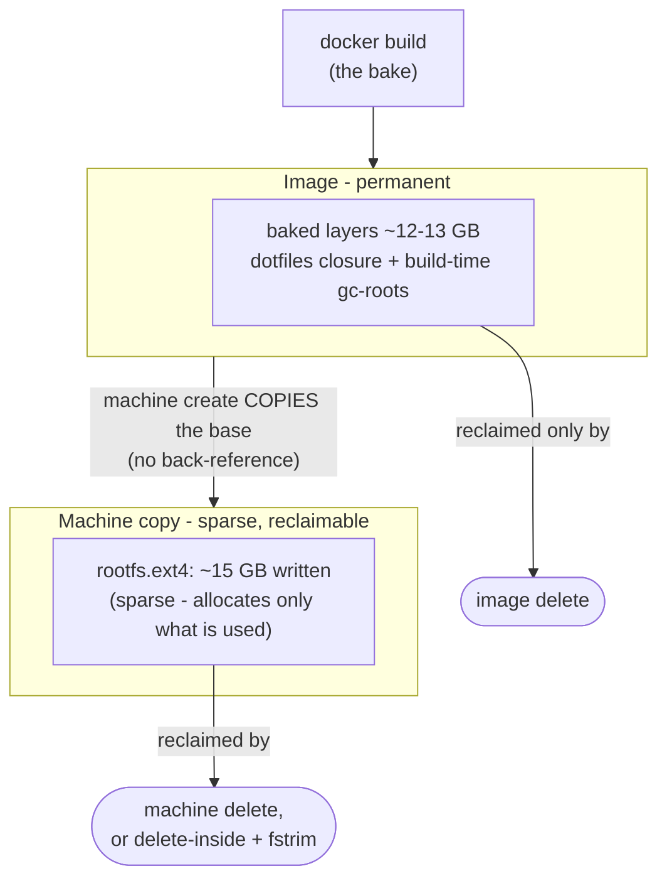

# Storage cost

Baking is convenience bought with disk, and the cost has two halves that
behave very differently - the **image** (permanent) and the **machine's
copy** (sparse, reclaimable). This page expands the storage note in the
[container-machine README](../README.md); for what a container machine *is*
and why the repo uses one, start there and at
[how-it-works.md](./how-it-works.md).

## The image is permanent

- The images land ~12-13 GB against a 1.4 GB nixos-cm base - the dotfiles
  store closure is most of it.
- It is baked into the image's layers behind build-time gc-roots, so
  *nothing inside a machine reclaims it*: switching the `~/dotfiles`
  source, `nix-collect-garbage`, or deleting the machine all leave it.
- Only deleting the image reclaims it - and that reclaims in full even
  while machines from it still run, because `machine create` copies the
  base rather than referencing it.

## The machine's copy is reclaimable

- `machine create` copies the base rootfs into the machine's own
  `rootfs.ext4` - a sparse file that allocates host blocks only for what
  is written (~15 GB for a full dotfiles machine).
- Deleting the machine frees it entirely; removing content inside frees
  the blocks within the disk, but a `fstrim` is what actually hands them
  back to the host - deletion alone does not shrink the host file.
- One catch, and it is NixOS-specific: the baked `/nix/store` is mounted
  read-only and pinned by gc-roots, so `nix-collect-garbage` will not
  reclaim it - trimming it piecemeal means remounting `/nix/store`
  read-write and removing paths by hand. In practice, reclaim a machine
  by deleting the machine, not by surgically GCing the closure it was
  baked to keep.

## The manual route

The [manual provisioning route](../nixos/#b-skip-this-image-use-provisionnixos-cm)
pays nothing up front - its closure is built inside the machine disk, GCs
and shrinks with your actual config, and vanishes with the machine.

## Rule of thumb

Choose the image for a ready-to-boot machine worth a permanent ~12 GB per
flavor (the machine's own copy rides on top, sparse and reclaimable);
choose the base when you want the disk to track what you actually use.
